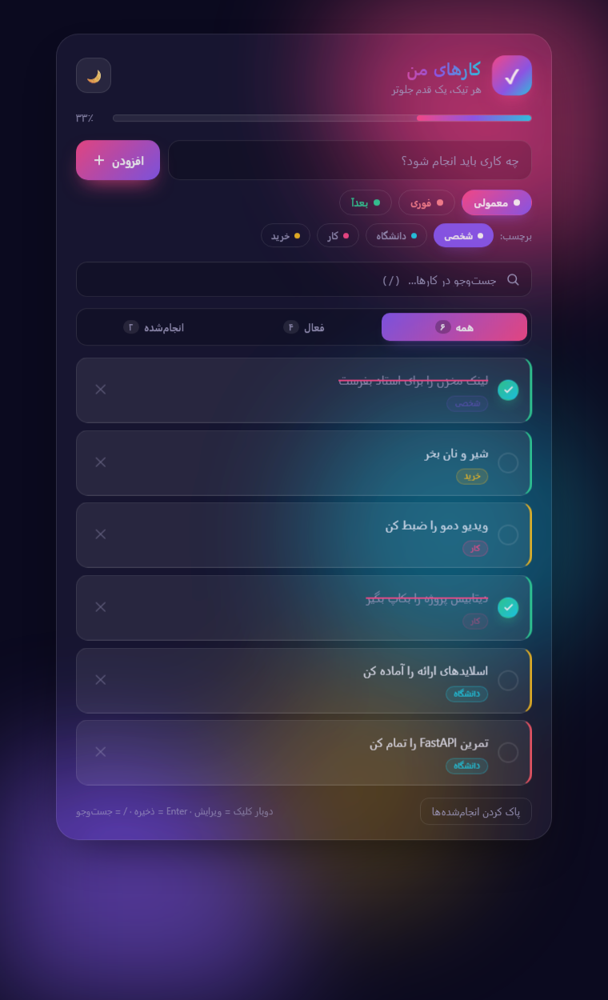

# کارهای من — تودولیست با بک‌اند FastAPI

تودولیست فارسی و راست‌به‌چپ با ظاهر شیشه‌ای و گرادیان‌های متحرک.
داده‌ها در **SQLite** روی سرور ذخیره می‌شوند، نه در مرورگر.



## معماری
```
مرورگر (HTML/CSS/JS)
      │  fetch  /api/todos
      ▼
FastAPI (app/main.py)
      │
      ▼
SQLite (data/todos.db)
```

| لایه | فایل | کار |
|---|---|---|
| API | `app/main.py` | مسیرهای REST، اعتبارسنجی، سرو کردن فرانت |
| داده | `app/db.py` | SQLite خالص، بدون ORM |
| فرانت | `static/` | رابط کاربری فارسی |
| اجرا | `run.py` | بالا آوردن سرور با یک کلیک ▶ |

## اجرا
**در VS Code:** فایل `run.py` را باز کن و دکمه‌ی **▶** را بزن (یا `F5`).
سرور روی اولین پورت آزاد بالا می‌آید و مرورگر خودکار باز می‌شود.

**در ترمینال:**
```powershell
cd E:\university\vscode\test1
python -m pip install -r requirements.txt   # فقط بار اول
python run.py
```

- سایت: <http://127.0.0.1:8080>
- مستندات خودکار API: <http://127.0.0.1:8080/docs>

## مسیرهای API
| متد | مسیر | توضیح |
|---|---|---|
| `GET` | `/api/todos` | فهرست کارها — پارامترها: `status`، `tag`، `q` |
| `POST` | `/api/todos` | افزودن — بدنه: `{"text","prio","tag"}` |
| `PATCH` | `/api/todos/{id}` | ویرایش جزئی (متن، انجام‌شدن، اولویت، برچسب) |
| `DELETE` | `/api/todos/{id}` | حذف |
| `POST` | `/api/todos/clear-done` | پاک کردن همه‌ی انجام‌شده‌ها |
| `GET` | `/api/stats` | آمار کلی |

### نمونه با PowerShell
```powershell
$body = [System.Text.Encoding]::UTF8.GetBytes('{"text":"تمرین SQL","prio":"high","tag":"uni"}')
Invoke-RestMethod -Uri http://127.0.0.1:8080/api/todos -Method Post `
  -ContentType "application/json" -Body $body
```

## امکانات فرانت
- افزودن با Enter، سه سطح اولویت رنگی
- تیک با انیمیشن، ویرایش با دوبار کلیک، حذف با انیمیشن
- فیلتر همه/فعال/انجام‌شده + شمارنده
- جست‌وجوی زنده با کلید `/`
- برچسب رنگی (شخصی/دانشگاه/کار/خرید) و فیلتر با کلیک
- نوار پیشرفت درصدی، تم روشن و تاریک
- واکنش‌گرا و سازگار با `prefers-reduced-motion`

## تست
```powershell
python check.py
```
هفت بررسی: سلامت API، ایجاد، ویرایش، حذف، اعتبارسنجی و سرو شدن صفحه.

## ساختار
```
app/
  main.py      مسیرهای FastAPI
  db.py        لایه‌ی SQLite
  __init__.py
static/
  index.html   ساختار صفحه
  styles.css   تم و انیمیشن‌ها
  app.js       منطق فرانت (fetch)
data/
  todos.db     پایگاه داده (خودکار ساخته می‌شود)
run.py         اجرای سرور با ▶
check.py       تست دودی
```

## نکته
بار اول که دیتابیس ساخته می‌شود، چند کار نمونه در آن قرار می‌گیرد تا صفحه خالی نباشد.
برای شروع از صفر، فایل `data/todos.db` را پاک کن.
